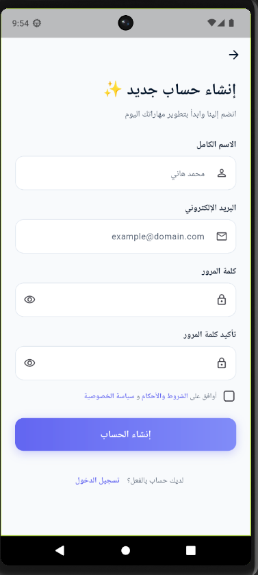
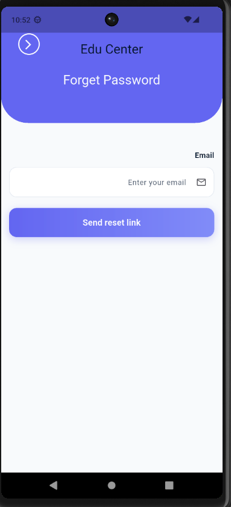
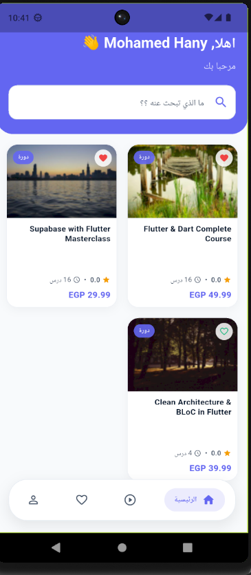
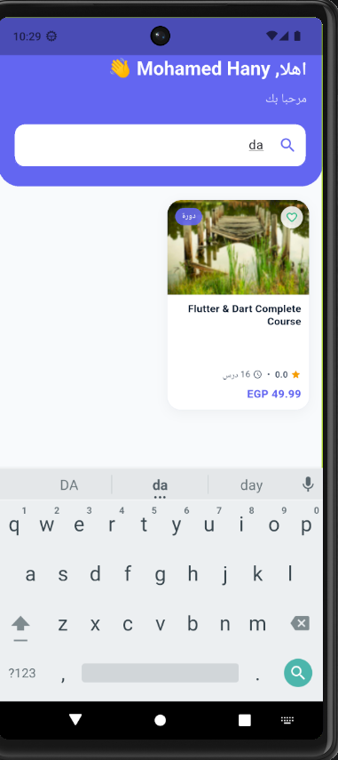
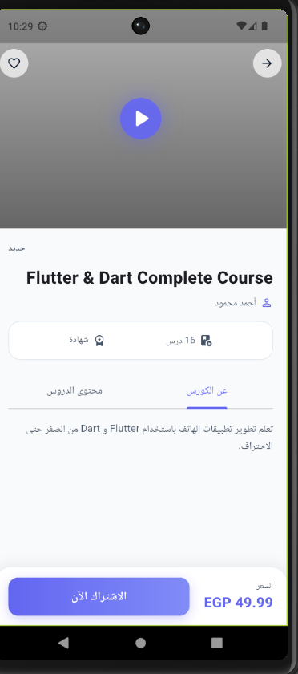
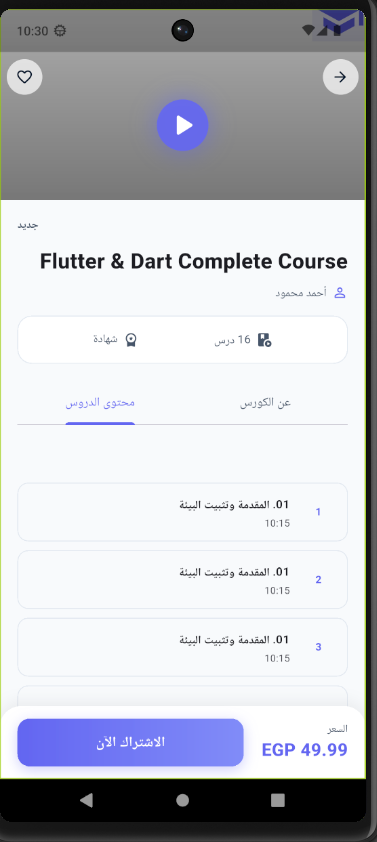
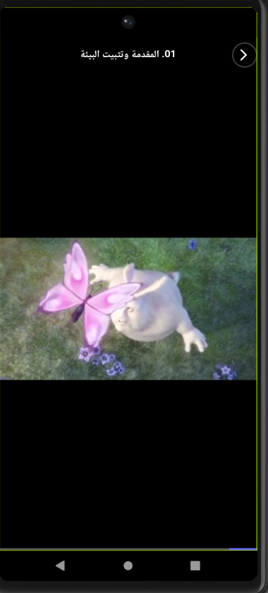
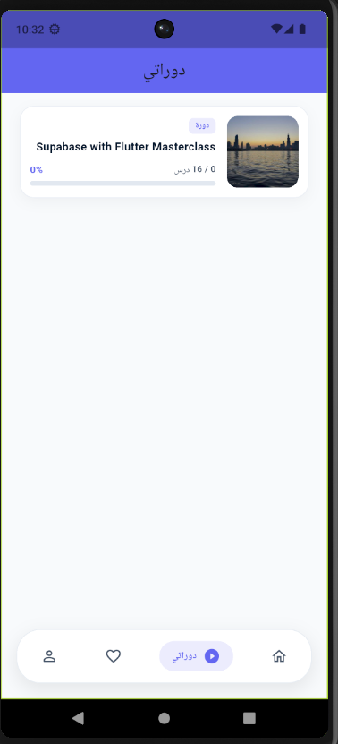
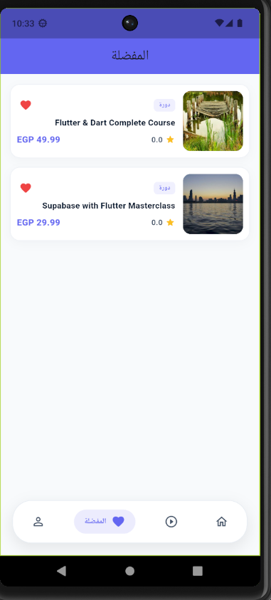
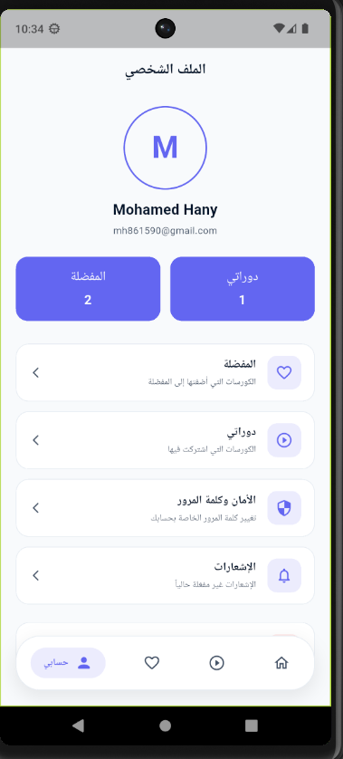

EduCenter 🎓

A modern Flutter e-learning application designed to provide a complete course discovery and learning experience, with Supabase powering authentication and backend data.

The project is built with a feature-based architecture and BLoC/Cubit state management, with reusable widgets, clear data/presentation separation, localization, and responsive UI.

📱 Screenshots

Authentication

Login

Sign Up

Forgot Password

Course Experience

Home

Search

Course Details

Course Content

Course Video

My Courses

User Area

Favorites

Profile

✨ Features

🔐 Authentication

User registration

Email/password login

Password reset

Password change

Logout

Authentication-aware navigation

Social login UI for Google and Apple

📚 Course Discovery

Browse available courses

Course search

Course details

Course information and metadata

Course content and lessons

Dedicated course video screen

🎥 Learning Experience

View course lessons

Access course videos

Navigate through course content

Dedicated My Courses section

❤️ Favorites

Add courses to favorites

Remove courses from favorites

Dedicated favorites screen

Persistent favorite data

👤 Profile

View user profile

Account management

Password management

Logout

🎨 UI / UX

Modern mobile-first interface

Reusable widgets

Loading states

Error handling

Empty states

Light and Dark theme support

Arabic and English localization

Responsive layouts

🏗️ Architecture

The application follows a feature-first architecture that separates data handling from presentation.

lib/
├── core/
│   ├── classes/
│   ├── constants/
│   ├── extensions/
│   ├── models/
│   ├── networking/
│   ├── routing/
│   ├── shared_prefs/
│   ├── theme/
│   ├── utils/
│   ├── validators/
│   └── widgets/
│
└── features/
    ├── auth/
    ├── course_details/
    ├── course_videos/
    ├── home/
    ├── layout/
    ├── my_courses/
    ├── my_favorites/
    └── profile/

Each feature is organized into data and presentation responsibilities:

feature/
├── data/
│   ├── models/
│   └── repo/
│
└── presentation/
    ├── cubit/
    ├── pages/
    └── widgets/

This structure makes the project easier to maintain, test, and extend.

🧠 State Management

The project uses BLoC / Cubit for state management.

The general application flow is:

UI
 ↓
Cubit
 ↓
Repository
 ↓
Supabase

This keeps backend operations and application logic outside the UI layer and allows screens to react to predictable states such as:

Loading
Success
Empty
Failure

🗄️ Backend

The application uses Supabase as its backend platform.

Supabase is responsible for application data and authentication, including areas such as:

User authentication

User profiles

Courses

Course videos

User courses

Favorites

The presentation layer communicates with the backend through repositories rather than accessing Supabase directly from widgets.

🛠️ Tech Stack

Technology

Usage

Flutter

Cross-platform mobile application

Dart

Programming language

BLoC / Cubit

State management

Supabase

Backend and authentication

Shared Preferences

Local persistence

Dartz

Functional error/result handling

Flutter Localization

Arabic / English support

🔑 Authentication Flow

Application Start
       ↓
Initialize Backend
       ↓
Check Authentication Session
       ↓
 ┌───────────────┐
 │               │
Signed In     Signed Out
 │               │
 ↓               ↓
Main App      Auth Screens

The authentication layer also supports password recovery and account-related actions.

🧩 Reusable Components

The project uses shared UI components to reduce duplicated code and maintain visual consistency.

Examples include:

Custom buttons

Custom text fields

Password fields

Loading widgets

Error widgets

Empty-state widgets

Network image widgets

Shared navigation components

🛡️ Error Handling

Repository operations are separated from presentation logic, allowing Cubits to expose clear UI states.

Conceptually:

Repository
     ↓
Result / Either
     ↓
Cubit
     ↓
UI State
     ↓
Loading / Success / Error / Empty

This approach keeps error handling predictable and avoids putting backend logic directly inside widgets.

🌍 Localization

The application supports:

🇪🇬 Arabic

🇬🇧 English

Localization is integrated at the application level so screens can use translated content consistently.

⚙️ Getting Started

Prerequisites

Make sure Flutter is installed and configured correctly.

flutter doctor

1. Clone the repository

git clone <your-repository-url>
cd edu_app

2. Install dependencies

flutter pub get

3. Configure Supabase

Create a Supabase project and configure the required backend credentials and database structure.

You will need to configure:

Supabase project URL

Supabase publishable/anon key

Authentication

Database tables

Required Row Level Security (RLS) policies

Do not commit private backend credentials or secrets to the repository.

4. Run the application

flutter run

📂 Project Structure

edu_app/
│
├── assets/
│   ├── images/
│   └── screenshots/
│
├── lib/
│   ├── core/
│   ├── features/
│   └── main.dart
│
└── README.md

🎯 Project Goals

EduCenter was developed as a real-world Flutter application rather than a simple UI demonstration.

The main goals were:

Build a scalable Flutter project

Apply feature-based architecture

Separate presentation and data layers

Integrate a real backend

Implement authentication

Manage application state with Cubit

Build reusable UI components

Handle loading, empty, and error states

Support multiple languages

Provide a complete course-learning experience

🚀 Future Improvements

Possible future additions include:

Course progress tracking

Lesson completion tracking

Payment integration

Push notifications

Course reviews and ratings

Instructor dashboard

Admin dashboard

Advanced course filtering

Offline learning support

Automated testing

CI/CD pipeline

👨‍💻 Author

Mohamed Hany

Flutter Developer

Focused on building clean, scalable, and user-friendly mobile applications using Flutter and modern backend technologies.

📄 License

This project is intended for educational and portfolio purposes.